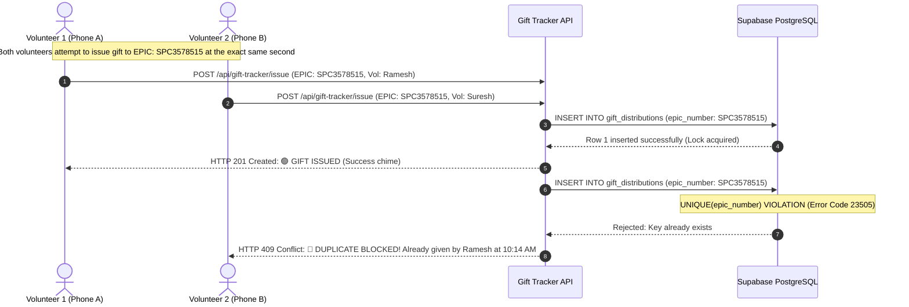
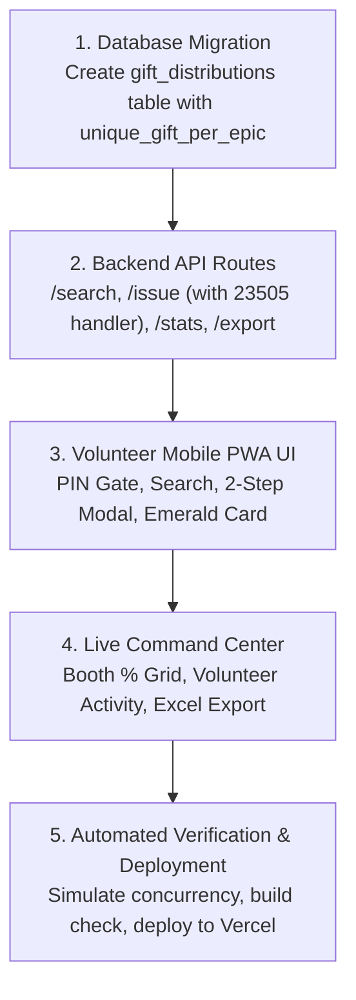

# Master Architectural Blueprint & Zero-Error Implementation Plan
## MLC 2026 Gift Tracker (ಉಡುಗೊರೆ ವಿತರಣಾ ಪೋರ್ಟಲ್)
### Dedicated Private PWA for 1-to-1 Voter Gift Distribution & Anti-Fraud Verification

---

## 1. Executive Summary & Core Mission

During high-stakes electoral campaigns (such as the **Karnataka MLC 2026 South-East Graduates' Constituency** spanning **1,92,696 graduate electors across 151 polling booths in 5 districts**), distributing candidate appreciation gifts or voter kits involves significant logistics, capital, and trust.

### The Problem Solved:
1. **Strict 1-Gift-Per-Elector Rule:** Zero duplicate distributions. If a voter has already received an item, any subsequent attempt by any volunteer in any booth is physically rejected by the database engine.
2. **Field Usability Under Sun:** Fast search by **Voter Name** or **EPIC Card Number** (no barcode/camera scanner needed).
3. **Confirmation Safety (Anti-Accidental Tap):** 2-step verification — tapping `[ ☑️ Tick: Hand Over Gift ]` triggers a quick pop-up confirmation: *"Confirm gift to [Voter Name]?"* to completely prevent accidental taps while walking.
4. **Complete Privacy:** Fully gated behind a 4-digit Team PIN (`2026`) so unauthorized public users or opponents have zero access.
5. **Live Transparency for Leadership:** Central live dashboard showing booth-by-booth percentage progress and 1-click Excel/CSV export.

---

## 2. Decision Alignment Summary

| Parameter | Decision | Rationale |
| :--- | :--- | :--- |
| **App Title** | **"MLC 2026 Gift Tracker" (ಉಡುಗೊರೆ ವಿತರಣಾ ಪೋರ್ಟಲ್)** | Clear bilingual branding matching campaign identity. |
| **Lookup Method** | **Search by Voter Name or EPIC Number** | Eliminates camera focus issues in sunlight; instant 250ms debounce. |
| **Confirmation Safety** | **1-Tap + Quick Pop-Up Modal** | Prevents accidental pocket/walking touches while preserving rapid field pace. |
| **Duplicate Prevention** | **PostgreSQL Engine-Level Unique Key** | `CONSTRAINT unique_gift_per_epic UNIQUE (epic_number)` blocks race conditions. |
| **Access Gate** | **4-Digit Team PIN (`2026`) + Volunteer Name & Booth** | Instant field login without complex email/passwords. |
| **Audit Log & Export** | **1-Click Excel / CSV Download** | Downloadable audited record with volunteer name, timestamp, and location. |

---

## 3. Mathematical Zero-Error Architecture: The Anti-Duplicate Engine



### Database Schema Definition (`Supabase PostgreSQL`)

```sql
-- 1. Distribution tracking table
CREATE TABLE IF NOT EXISTS gift_distributions (
  id UUID PRIMARY KEY DEFAULT gen_random_uuid(),
  
  -- Elector Identity
  epic_number TEXT NOT NULL,
  elector_name TEXT NOT NULL,
  relative_name TEXT,
  part_number TEXT NOT NULL,
  serial_number TEXT NOT NULL,
  district TEXT NOT NULL,
  taluk TEXT NOT NULL,
  polling_station_name TEXT,
  
  -- Volunteer & Delivery Details
  volunteer_name TEXT NOT NULL,
  volunteer_phone TEXT,
  recipient_mobile TEXT,
  booth_part TEXT NOT NULL,
  delivery_status TEXT NOT NULL DEFAULT 'DELIVERED',
  notes TEXT,
  
  -- Timestamps
  issued_at TIMESTAMPTZ NOT NULL DEFAULT NOW(),
  created_at TIMESTAMPTZ NOT NULL DEFAULT NOW(),

  -- 🔒 HARD ZERO-DUPLICATE CONSTRAINT
  CONSTRAINT unique_gift_per_epic UNIQUE (epic_number)
);

CREATE INDEX IF NOT EXISTS idx_gift_epic ON gift_distributions(epic_number);
CREATE INDEX IF NOT EXISTS idx_gift_part ON gift_distributions(part_number);
CREATE INDEX IF NOT EXISTS idx_gift_volunteer ON gift_distributions(volunteer_name);
CREATE INDEX IF NOT EXISTS idx_gift_issued_at ON gift_distributions(issued_at DESC);
```

---

## 4. Mobile User Experience & Screen Flows

```text
┌────────────────────────────────────────────────────────┐
│ 🏛️ MLC 2026 GIFT TRACKER · ಉಡುಗೊರೆ ವಿತರಣೆ             │
│ Volunteer: Manjunath K (Booth 71)            [Exit]    │
├────────────────────────────────────────────────────────┤
│ 📊 BOOTH 71 PROGRESS: 52 / 852 Gifts (6.1%)            │
│ [███░░░░░░░░░░░░░░░░░░░░░░░░░░░░░░░░░░░░░░░░░]        │
├────────────────────────────────────────────────────────┤
│ 🔍 [ Search Voter Name or EPIC (e.g. Suresh / SPC)   ] │
│ Filter: [ Booth 71 - Handanakere ▼ ] [ All | Not Given]│
├────────────────────────────────────────────────────────┤
│                                                        │
│ ┌────────────────────────────────────────────────────┐ │
│ │ SL. 2 · PART 71                     [ ⚪ NOT GIVEN ]│ │
│ │ Abhilasha S                                        │ │
│ │ Relative: Arunkumar K S                            │ │
│ │ EPIC: SPC3578515 · Chikkanayakanahalli             │ │
│ │ ────────────────────────────────────────────────── │ │
│ │ [ ☑️ TICK: HAND OVER GIFT / ಉಡುಗೊರೆ ನೀಡಲಾಗಿದೆ ]     │ │
│ └────────────────────────────────────────────────────┘ │
│                                                        │
│ ┌────────────────────────────────────────────────────┐ │
│ │ SL. 14 · PART 71                  [ 🟢 GIFT ISSUED ]│ │
│ │ Chandrashekar M                                    │ │
│ │ Relative: Mallappa                                 │ │
│ │ EPIC: IUO1294812 · Handanakere                     │ │
│ │ ────────────────────────────────────────────────── │ │
│ │ ✓ Given on 15 Oct, 10:14 AM by Manjunath K         │ │
│ │ 🔒 [ Delivery Confirmed - Locked ]                 │ │
│ └────────────────────────────────────────────────────┘ │
└────────────────────────────────────────────────────────┘
```

### 2-Step Confirmation Modal Flow:
```text
┌────────────────────────────────────────────────────────┐
│ 🎁 Confirm Gift Handover                               │
│ ಉಡುಗೊರೆ ಹಸ್ತಾಂತರವನ್ನು ಖಚಿತಪಡಿಸಿ                        │
├────────────────────────────────────────────────────────┤
│ Are you sure you want to mark gift as issued to:       │
│                                                        │
│ 👤 Elector:   ABHILASHA S                              │
│ 📜 Relative:  Arunkumar K S                            │
│ 🔢 Sl No:     2   ·   Part / Booth: 71                 │
│ 🆔 EPIC:      SPC3578515                               │
│                                                        │
│ ⚠️ Note: This action cannot be undone.                 │
│ Only 1 gift is permitted per elector.                  │
├────────────────────────────────────────────────────────┤
│ [ ✓ YES, CONFIRM & ISSUE ]            [ CANCEL ]       │
└────────────────────────────────────────────────────────┘
```

---

## 5. Implementation Roadmap


